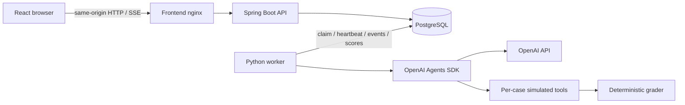

# Architecture

The browser never connects to the worker, PostgreSQL, or provider. Only the worker has the model key. The four predefined tools operate solely on in-memory fictional data, independently reset for every case and agent. No model-produced code is executed.

## Persistence and snapshots

Flyway is the only schema owner. The API uses explicit JDBC repositories, records/DTOs, services, and controllers. JDBC is a deliberate alternative to Hibernate here: the API and Python worker need an explicit, shared SQL contract and queue locking behavior. No ORM schema generation runs.

Six tables store agent configurations, scenarios, cases, runs, events, and results. Agent revisions are append-only within a family. Saving from any old version allocates the next version under a family row lock. The API snapshots configuration, scenario policy/version, selected fixtures, and execution limits into each run before queueing. Later prompt edits and fixture changes cannot change a historical run.

Comparisons insert two runs atomically with the same scenario and case snapshots and a shared comparison UUID. Each execution initializes a separate simulation. The UI labels versions explicitly.

## Queue lifecycle

1. API validates input, locks queue admission, snapshots data, inserts `QUEUED`, and returns HTTP 202.
2. Worker serializes capacity/spend accounting with a transaction-scoped PostgreSQL advisory lock. It claims one queued row with `FOR UPDATE SKIP LOCKED` in a short transaction.
3. Worker reserves conservative spend, writes `RUN_STARTED`, sets its owner UUID, and starts a 30-second lease. Network/model calls happen outside transactions.
4. Every five seconds a separate async task heartbeats the lease. Every persistent write locks the run row and checks owner, status, and unexpired lease. A stale worker cannot append events or overwrite results after recovery.
5. Each case receives a fresh sandbox. Tools enforce business rules; the scorer observes both successful state changes and rejected attempts.
6. Case results and `CASE_COMPLETED` commit together. Final status, cost, usage, and terminal event commit together.
7. Workers reap expired leases as `FAILED`, retaining uncertain spend reservations. They never automatically requeue potentially paid calls. The user can explicitly queue a new run.

Graceful termination stops claiming and lets the current run finish (Compose grants 130 seconds). A longer run interrupted by shutdown fails through lease recovery on the next worker start. A database outage fences work when heartbeat/persistence fails; the run is recovered rather than silently retried.

## Ordered replay

A global identity is the SSE event ID; a per-run sequence is the readable timeline order. Run row locks serialize event allocation and commit, so per-run reconnect cursors cannot skip an event committed out of order. Events include case IDs, types, timestamps, and structured JSON payloads.

The API polls persisted events every 250 ms, batches up to 200 per stream, sends keepalive comments, and caps active streams at 128. On reconnect it honors `Last-Event-ID` (or the initial `after` query cursor). Terminal status is read before each event batch to avoid closing across the final event transaction. Clients deduplicate events and close on `end`; completed traces remain replayable through REST and SSE.

The SDK adapter records visible assistant messages, model usage, tool requests/responses, and final structured decisions. It intentionally excludes hidden reasoning items. External tracing is disabled.

## Frontend

React Router owns page navigation; TanStack Query handles data fetching, errors, caching, and status polling. SSE adds the live chronological trace; results polling recovers independently of a transient stream disconnect. Case payloads and prompts are rendered as text, never HTML. Native controls and expandable details support keyboard use. Layouts are tested at desktop and mobile widths.
